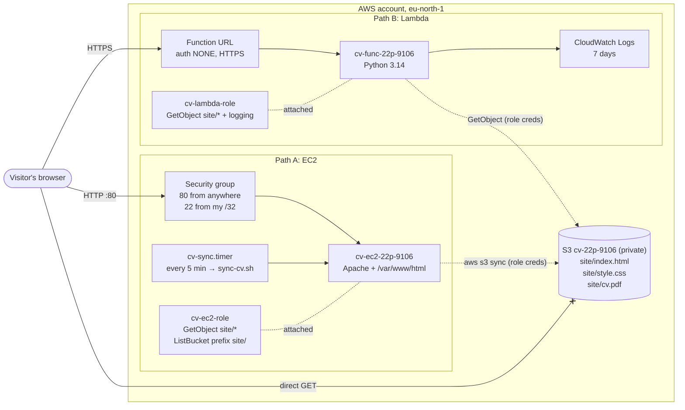

# Host Your CV on AWS

**Muhammad Rehan, 22P-9106.** Region `eu-north-1` (Stockholm).

My CV is served twice from one private S3 bucket: once by Apache on an EC2 instance and once by a Lambda function URL.

| Path | Address |
|---|---|
| EC2 | <!-- EC2_URL -->http://13.51.146.189<!-- /EC2_URL --> |
| Lambda | <!-- LAMBDA_URL -->https://xv6bjoaq5l43foycqzepwmcyrm0pxwzs.lambda-url.eu-north-1.on.aws/<!-- /LAMBDA_URL --> |
| S3 (direct, refused) | https://cv-22p-9106.s3.eu-north-1.amazonaws.com/site/index.html |

## Resources

| Resource | Name |
|---|---|
| S3 bucket | `cv-22p-9106` (private, versioned, all four Block Public Access settings on) |
| EC2 instance | `cv-ec2-22p-9106`, t3.micro, Amazon Linux 2023, IMDSv2 required |
| EC2 role | `cv-ec2-role-22p-9106` (+ instance profile of the same name) |
| Security group | `cv-sg-22p-9106`: TCP 80 from `0.0.0.0/0`, TCP 22 from my own `/32` only |
| Lambda function | `cv-func-22p-9106`, Python 3.14, 128 MB, 10 s timeout, function URL with auth `NONE` |
| Lambda role | `cv-lambda-role-22p-9106` |
| Log group | `/aws/lambda/cv-func-22p-9106`, retention 7 days |

All of them are tagged `Owner=22P-9106` and `Course=cloud`. There are no access keys anywhere: the instance and the function get temporary credentials from their roles.

## Diagram



**EC2 path:** the browser connects to the instance's public IP on port 80 and Apache answers from `/var/www/html`, which `sync-cv.sh` refreshes from `s3://cv-22p-9106/site/` every 5 minutes using the instance role and stamps with `EC2 <instance-id>`. **Lambda path:** the browser calls the HTTPS function URL, Lambda runs `app.handler`, which reads the requested object from S3 with the function's role, swaps the placeholder for `Lambda cv-func-22p-9106` and returns it (the PDF base64-encoded), while a direct request to the bucket is refused because nothing in it is public.

## Repository layout

```
README.md              this file
collect-evidence.sh    builds evidence.txt (bucket, roles, SG, instance, endpoints, logs)
evidence.txt           output of my own run
site/                  index.html, style.css, cv.pdf  (uploaded to s3://cv-22p-9106/site/)
ec2/user-data.sh       first-boot script: Apache, sync script, systemd timer
ec2/sync-cv.sh         S3 → web root, placeholder → EC2 + instance ID, one log line per run
lambda/app.py          the function code
iam/                   trust and permission policy JSON for both roles
```

## Access denied from the instance

Run on the instance (`ec2-user`, connected with EC2 Instance Connect from my own IP). The role can read `site/` but cannot delete or overwrite anything:

<!-- DENY_OUTPUT -->
```
Warning: Permanently added '13.51.146.189' (ED25519) to the list of known hosts.
** WARNING: connection is not using a post-quantum key exchange algorithm.
** This session may be vulnerable to "store now, decrypt later" attacks.
** The server may need to be upgraded. See https://openssh.com/pq.html
+ whoami
ec2-user
ip-172-31-36-220.eu-north-1.compute.internal
+ hostname
+ aws sts get-caller-identity --query Arn --output text
arn:aws:sts::570814275197:assumed-role/cv-ec2-role-22p-9106/i-0e7761a33bff523a2
2026-11-22 18:22:44     109488 cv.pdf
+ aws s3 ls s3://cv-22p-9106/site/ --region eu-north-1
2026-11-22 18:22:36       3830 index.html
2026-11-22 18:22:42       2016 style.css
+ aws s3 rm s3://cv-22p-9106/site/index.html --region eu-north-1
delete failed: s3://cv-22p-9106/site/index.html An error occurred (AccessDenied) when calling the DeleteObject operation: User: arn:aws:sts::570814275197:assumed-role/cv-ec2-role-22p-9106/i-0e7761a33bff523a2 is not authorized to perform: s3:DeleteObject on resource: "arn:aws:s3:::cv-22p-9106/site/index.html" because no identity-based policy allows the s3:DeleteObject action
+ echo 'overwrite test'
+ aws s3 cp /tmp/x.html s3://cv-22p-9106/site/index.html --region eu-north-1
upload failed: ../../tmp/x.html to s3://cv-22p-9106/site/index.html An error occurred (AccessDenied) when calling the PutObject operation: User: arn:aws:sts::570814275197:assumed-role/cv-ec2-role-22p-9106/i-0e7761a33bff523a2 is not authorized to perform: s3:PutObject on resource: "arn:aws:s3:::cv-22p-9106/site/index.html" because no identity-based policy allows the s3:PutObject action
+ true
```
<!-- /DENY_OUTPUT -->

## Last 10 lines of /var/log/cv-sync.log

<!-- SYNC_LOG -->
```
2026-11-22T18:28:25Z sync=OK instance=i-0e7761a33bff523a2 source=s3://cv-22p-9106/site/
2026-11-22T18:30:02Z sync=OK instance=i-0e7761a33bff523a2 source=s3://cv-22p-9106/site/
2026-11-22T18:35:02Z sync=OK instance=i-0e7761a33bff523a2 source=s3://cv-22p-9106/site/
2026-11-22T18:40:02Z sync=OK instance=i-0e7761a33bff523a2 source=s3://cv-22p-9106/site/
```
<!-- /SYNC_LOG -->

## Written answers

**1. Why do the instance and the function use roles instead of access keys? What could go wrong if the keys were in the user data?**
A role hands out short-lived credentials that AWS rotates by itself, and they only carry the few permissions in the role's policy, so there is nothing long-lived to store, copy or leak. User data is not secret: any process on the instance can read it from the metadata service, anyone with `ec2:DescribeInstanceAttribute` can read it from the API, and in this lab it also sits in a public GitHub repository. A key in there would be found by the bots that scan GitHub within minutes. Whoever got it could act as that IAM user until someone noticed and deactivated it, for example by starting expensive instances on my account or reading and deleting data.

**2. Someone pastes the S3 address of index.html into a browser. What do they see, and which setting causes that?**
They get a 403 and a short XML document with `AccessDenied`, not the page. The request has no credentials, and the bucket has no bucket policy or ACL that allows anonymous reads, so S3 refuses it by default. The four Block Public Access settings make sure that stays true even if someone later adds a public ACL or policy by mistake, because S3 would ignore or reject it.

**3. Explain the permission on the function URL that lets anyone call it. Why is that acceptable for the function but not for the bucket?**
When the URL is created with auth type `NONE`, the function gets a resource-based policy statement with principal `*` and action `lambda:InvokeFunctionUrl`, with the condition `lambda:FunctionUrlAuthType = NONE` (newer accounts also get a matching `lambda:InvokeFunction` statement that only applies to calls through the URL). In plain words: anyone on the Internet may call this function through its URL without signing the request. That is fine for the function because the code decides what comes back: it only ever returns three fixed files read-only, sends 404 for everything else, and its role can only read `site/`. Opening the bucket instead would hand out every object and old version directly, with no code in between, and anything uploaded there later would be public too.

**4. Compare the two paths. What do you pay for when nobody visits the site? What happens if the traffic grows a hundred times?**
The EC2 path costs money every hour the instance is running, visitors or not: instance hours, the 8 GB EBS volume and the public IPv4 address (covered by the Free Tier/credits here, but still billed time). The Lambda path costs nothing for compute while idle, only the S3 storage for about 300 KB and the stored logs. With a hundred times more traffic, one t3.micro would run out of CPU credits and bandwidth, get slow and could fall over, and fixing that means a bigger instance or an Auto Scaling group behind a load balancer. Lambda runs more copies in parallel on its own up to the account's concurrency limit, so it keeps responding, and the bill grows in step with the number of requests and S3 GETs.

**5. You delete the EC2 instance. What do you lose and what do you still have?**
I lose the running server and the EC2 site, its root EBS volume (deleted on termination), the Apache setup and the history in `/var/log/cv-sync.log`, and the public IP address, which is not an Elastic IP and will not come back. I still have the bucket with all three files and their versions, the EC2 role and instance profile, the security group, and `user-data.sh` and `sync-cv.sh` in this repository. Launching a new instance with the same role, security group and user data rebuilds the site in a few minutes, only on a new address. The Lambda site keeps working the whole time because it does not depend on the instance.

## Sources

- AWS documentation: S3 Block Public Access, IAM policy condition keys for S3 (`s3:prefix`), EC2 instance metadata (IMDSv2), EC2 user data, Lambda function URLs and their resource-based policy, Lambda response format for binary payloads.
- Course lab manual for the names, layout and checks.
